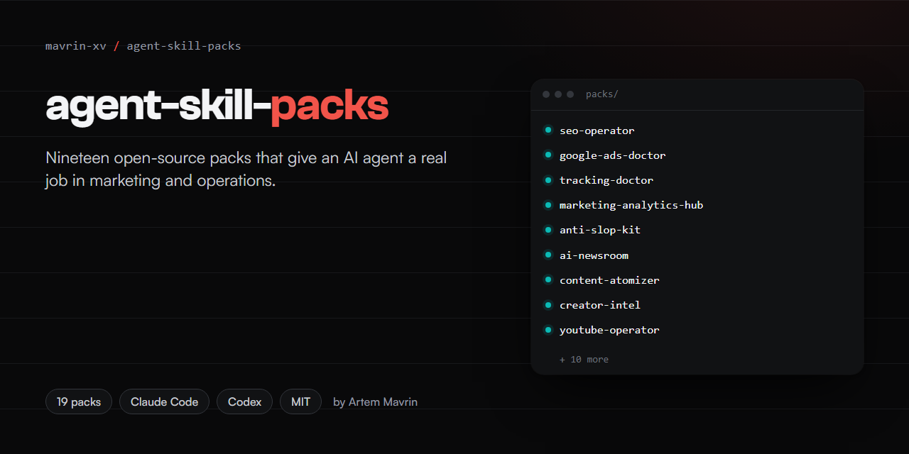

# agent-skill-packs

**Nineteen open-source packs that give an AI agent a real job in marketing and operations: SEO, ads, tracking, content, offers, analytics, a CRM, a sales bot and a family assistant.**

  

Most agent "skills" are a prompt in a folder. These came out of daily work, so each pack ships the parts a prompt cannot do: scripts that count and score, gates that exit non-zero, a worked example with real output, and a list of what it will not do.

Built by [Artem Mavrin](https://github.com/mavrin-xv). MIT licensed. Works with Claude Code, Codex and any agent that reads `SKILL.md`.

## Install any pack

```bash
git clone https://github.com/mavrin-xv/seo-operator && cd seo-operator
./install.sh                 # or: ./install.sh --project
```

In Claude Code you can skip the clone: `/plugin marketplace add mavrin-xv/seo-operator`, then `/plugin install seo-operator@seo-operator`. Swap the name for any pack below. Each pack is separate, and no two packs share a skill name, so you can install several side by side.

## The packs

### Traffic and tracking
| Pack | What it does |
|---|---|
| [seo-operator](https://github.com/mavrin-xv/seo-operator) | SEO as a weekly loop: measure, pick the one change worth the next hour, do it, check later whether it worked. |
| [google-ads-doctor](https://github.com/mavrin-xv/google-ads-doctor) | Finds where Google Ads money leaks and fixes it in order: conversions, search terms, negatives, structure. |
| [tracking-doctor](https://github.com/mavrin-xv/tracking-doctor) | Explains why pixels and analytics disagree with orders, then audits consent, server events and attribution. |
| [marketing-analytics-hub](https://github.com/mavrin-xv/marketing-analytics-hub) | One dashboard and a morning report from GA4, Search Console, Google Ads and PostHog on a Cloudflare Worker. |

### Content
| Pack | What it does |
|---|---|
| [anti-slop-kit](https://github.com/mavrin-xv/anti-slop-kit) | A grep gate, a pattern check and a critic loop that make AI-assisted writing read like its author. |
| [ai-newsroom](https://github.com/mavrin-xv/ai-newsroom) | Five blind editors and a chief editor who returns one fix list and a SHIP, FIX or REWRITE verdict. |
| [content-atomizer](https://github.com/mavrin-xv/content-atomizer) | One article or transcript into native posts per platform, each with its own angle. |
| [creator-intel](https://github.com/mavrin-xv/creator-intel) | A creator teardown from a handle: metrics, outliers, hooks, CTA and what to copy. |
| [youtube-operator](https://github.com/mavrin-xv/youtube-operator) | Topic choice, title and thumbnail before the script, a publish package and a review of what to change. |

### Offers and sales
| Pack | What it does |
|---|---|
| [offer-lab](https://github.com/mavrin-xv/offer-lab) | From a skill or an idea to a priced, tested offer with evidence caps on every score. |
| [landing-factory](https://github.com/mavrin-xv/landing-factory) | A landing page built in rounds, each round checked by scripts and screenshots. |
| [lead-magnet-factory](https://github.com/mavrin-xv/lead-magnet-factory) | A short lead magnet people finish, the comment-to-DM flow and the posts that promote it. |
| [ads-creative-lab](https://github.com/mavrin-xv/ads-creative-lab) | A paid-social creative loop: concepts, safe-zone checks, a paused launch and a read on results. |
| [telegram-sales-bot](https://github.com/mavrin-xv/telegram-sales-bot) | A Telegram sales assistant that answers from your catalog and prices orders in code. |
| [mini-crm-site](https://github.com/mavrin-xv/mini-crm-site) | A website and a CRM for a small service business on one Cloudflare Worker and one D1 database. |

### Running things
| Pack | What it does |
|---|---|
| [decision-council](https://github.com/mavrin-xv/decision-council) | Five advisors argue, review each other blind, a chairman decides, then a pre-mortem and a log entry. |
| [daily-briefing-agent](https://github.com/mavrin-xv/daily-briefing-agent) | A morning brief, an evening review and a signals digest, with every failed step printed at the top. |
| [second-brain-for-agents](https://github.com/mavrin-xv/second-brain-for-agents) | A markdown vault the agent files into, compiles into a cited wiki and cleans up with your approval. |
| [butler](https://github.com/mavrin-xv/butler) | A family assistant in a Telegram group: expenses, budgets, to-dos, birthdays and a house wiki. |

## Where to start

- You run a site and want more traffic: `seo-operator`, then `tracking-doctor`.
- You spend on ads: `google-ads-doctor` for search, `ads-creative-lab` for paid social.
- You publish with AI and it shows: `anti-slop-kit`, then `ai-newsroom`.
- You have a skill and no offer yet: `offer-lab`, then `landing-factory` and `lead-magnet-factory`.

## What every pack has

- `README.md` with a quick start you can paste, and an "Honest limits" section.
- `skills/<name>/SKILL.md` per skill, with the detail in `references/` and the arithmetic in `scripts/`.
- `examples/` with a fictional company and the real output of each script.
- `install.sh` that backs up any skill it would overwrite.
- No account names, keys or client data. Secrets come from environment variables you set.

## License

MIT for every pack. Issues and pull requests are welcome in the repo they concern.
